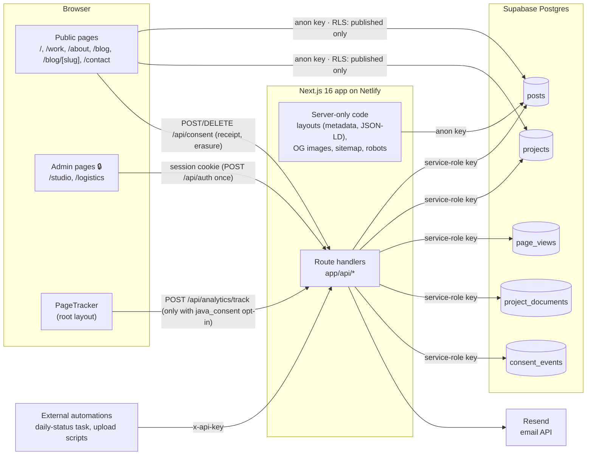
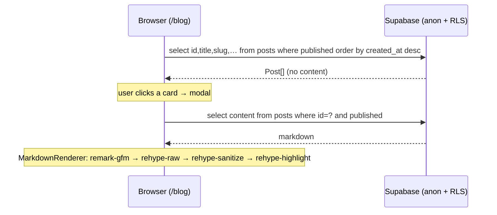
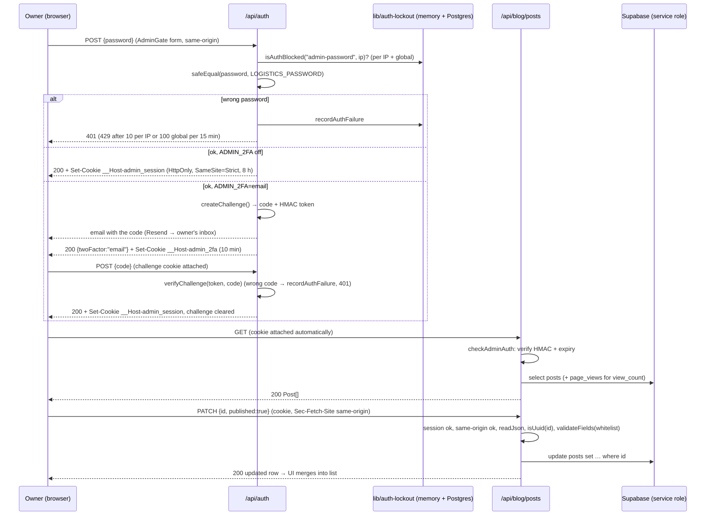

# Architecture

_How the system is put together: the runtime model, data flow, the API contract, the data model, configuration, deployment, and recipes for extending it. Last verified against the code: **2026-10-21** (branch `security-sweep`)._

Related docs: [SECURITY.md](SECURITY.md) covers the controls in depth, [PRD.md](PRD.md) covers what each feature must do, and [CODE_STYLE.md](CODE_STYLE.md) covers how to write it.

---

## 1. System overview



**The core rule:** the browser only ever talks to Supabase with the **anon key**, and RLS limits that key to `published = true` rows of `posts` and `projects`. Every write, and every read of private data (drafts, analytics, docs), goes through an **authenticated route handler** that uses the **service-role key**. The service-role key never leaves the server.

## 2. Tech stack

| Layer | Choice | Version (installed) | Notes |
|---|---|---|---|
| Framework | Next.js App Router | 16.3.8 | Turbopack by default. Read `node_modules/next/dist/docs/` before using any Next API. |
| UI | React | 19.2.4 | Most pages are client components (see §4) |
| Language | TypeScript | 5.9 | `strict: true`; path alias `@/*` points at the repo root |
| Styling | Tailwind CSS (`@tailwindcss/postcss`) | 4.2 | No `tailwind.config.*`. The theme lives in `app/globals.css` (`@theme inline`). See DESIGN_SYSTEM.md. |
| Database | Supabase Postgres (`@supabase/supabase-js`) | ^2.104 | Two clients: anon and service role |
| Markdown | `react-markdown` 10, `remark-gfm` 4, `rehype-raw` 7, `rehype-sanitize` 6, `rehype-highlight` 7 (highlight.js 11) | | Used only in `components/ui/MarkdownRenderer.tsx` |
| Frontmatter | `gray-matter` | ^4 | Used only by `/api/blog/upload` |
| Email | `resend` | 4.8 | Used only by `/api/email-summary` |
| Icons | `react-icons` (`rx`, `fa6`, `md`, `io5`), plus inline SVG paths in `app/studio/shared.tsx` | ^5.6 | |
| Tests | Jest 30 with `babel-jest` (inline config) | | See TESTING.md |
| Lint | ESLint 9 flat config + `eslint-config-next` 16.3.8 | | `npm run lint` |
| Hosting | Netlify | | No `netlify.toml`; Netlify's Next.js runtime is auto-detected |
| Node | 20.9+ required by Next 16 | dev machine: 22.13 | |

## 3. Repository layout

```
.
├── app/
│   ├── layout.tsx                 Root layout: Geist fonts (next/font), escaped Person JSON-LD,
│   │                              Person JSON-LD, site-wide metadata, <PageTracker/>
│   ├── globals.css                Tailwind import, highlight.js theme, CSS vars, @theme inline
│   ├── page.tsx                   Home (Server Component shell → <Navbar/> + <HomeComponent/>)
│   ├── opengraph-image.tsx        Site OG image (ImageResponse, 1200×630)
│   ├── robots.ts, sitemap.ts      SEO (sitemap includes published posts)
│   ├── privacy/ page.tsx (server): privacy & cookie policy, generated from lib/consent constants
│   ├── about/   page.tsx (client) + layout.tsx (metadata only)
│   ├── work/    page.tsx (client) + layout.tsx (metadata only)
│   ├── contact/ page.tsx (client) + layout.tsx (metadata only)
│   ├── blog/    page.tsx (client) + layout.tsx (metadata only)
│   │   └── [slug]/ page.tsx (client), layout.tsx (server: generateMetadata + BlogPosting JSON-LD),
│   │               opengraph-image.tsx (per-post OG)
│   ├── studio/  🔒 page.tsx (gate + tabs), BlogsPanel.tsx, ProjectsPanel.tsx, ProjectWizardModal.tsx,
│   │               shared.tsx (Icon + ICON_PATHS, formatDate), layout.tsx (noindex)
│   ├── logistics/ 🔒 page.tsx (AdminGate + Dashboard), layout.tsx (noindex)
│   └── api/
│       ├── analytics/track/route.ts   POST (public)
│       ├── auth/route.ts              GET (session?) / POST (sign in → cookie) / DELETE (sign out)
│       ├── consent/route.ts           POST (consent receipt) / DELETE (erase this browser's analytics); same-origin only
│       ├── analytics/stats/route.ts   GET  (admin); also exports StatsPayload type
│       ├── blog/posts/route.ts        GET/POST/PATCH/DELETE (admin)
│       ├── blog/upload/route.ts       POST (x-api-key = BLOG_UPLOAD_SECRET)
│       ├── projects/route.ts          GET/POST/PATCH/DELETE (admin)
│       ├── docs/upload/route.ts       POST (x-api-key = DOCS_UPLOAD_SECRET)
│       └── email-summary/route.ts     POST (x-api-key = EMAIL_SUMMARY_SECRET)
├── components/
│   ├── index.tsx                  Barrel: Navbar, HomeComponent, WorkComponent, ComingSoon, ProjectList, MarkdownRenderer, Modal
│   ├── ui/                        Navbar, Home, WorkComponent, ProjectList, MarkdownRenderer, PageTracker, ComingSoon (dead)
│   ├── features/                  Modal.tsx (portal modal), AdminGate.tsx (session check, password form, SignOutButton)
│   └── onboarding/                OnboardingProvider (consent + modal + tour state, in the root layout), IntroModal,
│                                  SitePreviews (live mini components), TourToolbar (rendered by Navbar), TourSpotlight,
│                                  SiteFooter, Toast, PrivacyActions, useFocusTrap
├── lib/
│   ├── supabase.ts                Anon client (browser-safe)
│   ├── supabase-admin.ts          Service-role client (SERVER ONLY)
│   ├── blog.ts                    Post types, themeMap, getPosts/getPostContent/getPostBySlug, formatDate
│   ├── projects-data.ts           PublicProject type, projectThemeMap, getPublicProjects
│   ├── projects.ts                LEGACY hard-coded project list, used only by WorkComponent (/work)
│   ├── security.ts                safeEqual (timing-safe), getClientIp (validated), ipBucket (IPv6 /64), isSameOriginRequest (CSRF)
│   ├── session.ts                 Signed, expiring admin session tokens + cookie options (__Host- in production)
│   ├── two-factor.ts              Optional emailed sign-in code (ADMIN_2FA=email): stateless challenge + Resend send
│   ├── admin-auth.ts              checkAdminAuth: session cookie (+CSRF) or x-logistics-key, with the shared lockout
│   ├── auth-lockout.ts            Brute-force lockout: in-memory layer + Postgres layer shared by all instances
│   ├── http.ts                    readJsonBody / readBodyText: byte-capped body readers (413), BODY_LIMITS
│   ├── json-ld.ts                 serializeJsonLd: XSS-safe JSON for <script type=ld+json>
│   ├── consent.ts                 java_consent cookie model (parse/serialize, version, allowsAnalytics, data-point list)
│   ├── tour.ts                    Tour steps + navigation rules (resolveTourIndex, upcomingPageChange)
│   ├── analytics.ts               Shared skip-prefixes + language/timezone validators (tracker and route)
│   ├── theme.ts                   Accent theme map (pure data; re-exported by lib/blog)
│   ├── user-agent.ts              Coarse browser/OS summary for the dashboard
│   ├── random-id.ts               UUID v4 that also works on plain-http origins
│   ├── supabase-errors.ts         isMissingColumn / isMissingTable / isMissingFunction for graceful schema drift
│   ├── rate-limit.ts              In-memory fixed-window limiter (10k-key cap) + per-IP and global auth lockout
│   ├── validation.ts              LIMITS, type-guard validators, normalizers, slugify, estimateReadingTime
│   └── markdown-sanitize.ts       rehype-sanitize allowlist schema
├── supabase/                      SQL to run in the Supabase SQL editor (no migration tool)
├── __tests__/                     Jest suites + helpers/test-utils.ts
├── public/                        resume.pdf + default Next SVGs (unused)
├── next.config.ts                 Security headers/CSP, vestigial PDF loader rules, allowedDevOrigins
├── jest.config.js, eslint.config.mjs, postcss.config.mjs, tsconfig.json, pdf.d.ts
└── *.md                           AGENTS, PRD, ARCHITECTURE, DESIGN_SYSTEM, SECURITY, CODE_STYLE, TESTING, README,
                                   PROJECT_OVERVIEW (automation-maintained log), CLAUDE (→ AGENTS)
```

## 4. Rendering and data-fetching model

The app currently follows a **"client pages + server metadata"** pattern. Each page is a client component that fetches its own data in `useEffect`. The server side contributes only metadata, JSON-LD, OG images, and the sitemap.

| Route | Page rendering | Data source | Key used | Notes |
|---|---|---|---|---|
| `/` | Server shell, client `HomeComponent` | `getPublicProjects()` in `useEffect` | anon | Skills and stats are hard-coded |
| `/work` | Client | `lib/projects.ts` (static import) | none | **Not Supabase.** See PRD P1-1. |
| `/about`, `/contact` | Client | Static arrays in the file | none | |
| `/blog` | Client | `getPosts()`, then `getPostContent(id)` when the modal opens | anon | |
| `/blog/[slug]` | Client page; **server** layout | Layout: cached `getPostBySlug` for metadata and JSON-LD. Page: `getPostBySlug` again on the client. | anon | The post is fetched twice. See PRD P1-4. |
| `/blog/[slug]/opengraph-image` | Server | `getPostBySlug` | anon | `await params` (Next 16) |
| `/sitemap.xml` | Server | `getPosts()` | anon | **Static** (`○` in the 2026-10-19 build), so new posts appear only after a redeploy. |
| `/privacy` | **Server** (static) with a client `PrivacyActions` child | `lib/consent` constants | none | The intro modal never auto-opens here, so the policy stays readable |
| All pages | `OnboardingProvider` (client) wraps everything in the root layout | `document.cookie` / storage after hydration | none | The modal, tour bar, and footer render client-side only, so static pages stay static (`○`) |
| `/studio`, `/logistics` | Client, wrapped in `<AdminGate>` | `fetch('/api/...')`; the browser attaches the HttpOnly session cookie | service role (server-side) | Renders nothing until `GET /api/auth` answers, then shows the password form or the page |

There are no Server Actions, `use cache`, `revalidate*` calls, `proxy.ts`, or route-segment config anywhere. Every API route is a plain route handler.

## 5. Data-access layer

| Module | Runs where | Purpose | Rules |
|---|---|---|---|
| `lib/supabase.ts` | Anywhere | `createClient(NEXT_PUBLIC_SUPABASE_URL, NEXT_PUBLIC_SUPABASE_ANON_KEY)` with every auth feature off (`persistSession`, `autoRefreshToken`, `detectSessionInUrl`), so a crafted `#access_token=` link can't plant a session | Logs a warning when env vars are missing, **but `createClient` throws on an empty URL at import time** |
| `lib/supabase-admin.ts` | **Server only** (`import "server-only"`) | Service-role client, auth features off | Never import from `"use client"` files (the build and `server-boundary.test.ts` both fail). Bypasses RLS. Also throws at import without env vars, so `lib/auth-lockout.ts` imports it lazily. |
| `lib/blog.ts` | Anywhere | `Post`, `PostWithContent`, `PostTheme`, `themeMap`; `getPosts()` (published, without content, newest first), `getPostContent(id)` (published only), `getPostBySlug(slug)` (published only; returns `null` for an invalid slug **without querying**, or on error), `formatDate` | Public reads always add `.eq("published", true)` on top of RLS, and select explicit columns (`POST_COLUMNS`), never `*` |
| `lib/projects-data.ts` | Anywhere | `PublicProject`, `projectThemeMap`, `getPublicProjects()` (published; featured first, then newest) | Same rule |
| `lib/projects.ts` | Anywhere | Legacy static `projects[]` with Tailwind classes baked in | Scheduled for deletion |
| `lib/validation.ts` | Server (pure) | `LIMITS`, `isValidSlug`, `isNonEmptyString`, `isStringMax`, `normalizeTags`, `normalizeTheme`, `normalizeProjectStatus`, `isValidUrlOrEmpty`, `estimateReadingTime`, `slugify` | Pure functions, fully unit-tested |
| `lib/security.ts` | Server only | `safeEqual` (SHA-256 both sides, then `timingSafeEqual`), `getClientIp` (`x-nf-client-connection-ip`, then first XFF entry, then `x-real-ip`, each kept only if it parses as an IP; else `"unknown"`), `ipBucket` (IPv6 → its /64, IPv4-mapped → IPv4), `isSameOriginRequest` (Sec-Fetch-Site, then Origin vs Host) | |
| `lib/session.ts` | Server only | `createSessionToken`, `verifySessionToken`, `sessionCookieOptions`, `SESSION_COOKIE` (`__Host-admin_session` in production, `admin_session` otherwise), `SESSION_TTL_SECONDS` (8 h), `getSessionKey` | The HMAC key derives from `SESSION_SECRET` (or the service-role key) plus `LOGISTICS_PASSWORD`; fails closed |
| `lib/two-factor.ts` | Server only | `isTwoFactorEnabled` (`ADMIN_2FA=email`), `isTwoFactorConfigured`, `createChallenge` / `verifyChallenge` (stateless HMAC over expiry + nonce + code, `admin-2fa-v1` prefix), `normalizeCode`, `sendCode` (Resend), `TWO_FACTOR_COOKIE` | Codes go only to `ADMIN_2FA_EMAIL` / `SUMMARY_RECIPIENT_EMAIL`; 10-minute challenges |
| `lib/admin-auth.ts` | Server only | `await checkAdminAuth(req)` returns a response to send, or null if allowed | The only auth check admin routes should use. Shares the `admin-password` lockout scope with `/api/auth`; refuses `x-logistics-key` while 2FA is on. |
| `lib/auth-lockout.ts` | Server only | `ADMIN_PASSWORD_SCOPE`, `await isAuthBlocked(scope, ip)`, `await recordAuthFailure(scope, ip)` | In-memory layer (`lib/rate-limit.ts`) plus Postgres RPCs from `auth-lockout-schema.sql`. Keys hold a hash, not the IP. Store errors fall back to memory. `AUTH_LOCKOUT_STORE=memory` skips the store (tests). |
| `lib/http.ts` | Server only | `readJsonBody(req, max)` → `{ok, body}` or `{ok:false, status: 400/413}`, `readBodyText(req, max)` (throws `BodyTooLargeError`), `BODY_LIMITS` | The only way routes read bodies; enforces the byte cap while streaming |
| `lib/json-ld.ts` | Anywhere | `serializeJsonLd(data)` | Escapes `<`, `>`, `&`, and U+2028/2029 |
| `lib/consent.ts` | Anywhere | `CONSENT_COOKIE`, `CONSENT_VERSION`, `parseConsent` (strict), `serializeConsent`, `allowsAnalytics`, `consentCookieString`, `readConsentFromCookieHeader`, `ANALYTICS_DATA_POINTS` | Cookie value `{"v","a":0/1,"t","id"}`, URI-encoded, 180 days, SameSite=Lax, readable by JS (it holds no secret) |
| `lib/tour.ts` | Anywhere | `TOUR_STEPS`, `NAV_ITEMS`, `resolveTourIndex`, `upcomingPageChange`, `firstStepForPath`, `tourPages` | Pure, unit-tested; targets map to `data-tour` attributes |
| `lib/analytics.ts` | Anywhere | `ANALYTICS_SKIP_PREFIXES`, `isTrackablePath`, `isValidPagePath` (URL path characters only), `normalizeLanguage`, `normalizeTimezone` | Replaces the old duplicated skip lists |
| `lib/supabase-errors.ts` | Server | `isMissingColumn` (42703/PGRST204), `isMissingTable` (42P01/PGRST205), `isMissingFunction` (PGRST202/42883), `warnSchemaOnce` | Lets code deploy before a SQL file runs |
| `lib/rate-limit.ts` | Server only | `rateLimit(name, key, limit, windowMs)`, the in-memory layer of the auth lockout (`isAuthBlocked` / `recordAuthFailure`, sync; routes use `lib/auth-lockout.ts` instead), `AUTH_FAIL_LIMIT` / `AUTH_GLOBAL_FAIL_LIMIT` / `AUTH_FAIL_WINDOW_MS`, `resetRateLimits()` (tests) | Module-level `Map`, so state is per process. Keys go through `ipBucket`. Each limiter is capped at 10k keys (expired buckets go first, then the oldest 10%). Auth damping: 10 failures per 15 min per IP, plus 100 per scope globally. |
| `lib/markdown-sanitize.ts` | Anywhere | `markdownSanitizeSchema` | Type-only import, so it has no runtime dependencies |

## 6. API reference

All handlers live in `app/api/**/route.ts`. Errors are always `{"error": "<generic message>"}`. Every JSON body must be a plain object (`null`, arrays, and scalars return 400). Every response carries `Cache-Control: no-store` and `X-Robots-Tag: noindex` (from `next.config.ts`).

**Admin routes** (marked "admin" below) call `await checkAdminAuth(req)` (SECURITY.md §4.1). A valid session cookie is accepted; for writes it must also pass the same-origin check, or the route returns 403. Without a cookie, the route falls back to the `x-logistics-key` header, which is refused while `ADMIN_2FA=email`. **Machine routes** take `x-api-key`. Wrong credentials count toward **10 per IP and 100 globally per 15 minutes**, after which the route returns `429 {"error":"Too many attempts. Try again later."}`. Requests with no credential get 401 but aren't counted. All four admin-password routes share one counter (scope `admin-password`); each machine route has its own.

**Bodies** are read with `lib/http.ts` and capped in bytes: 2 KB for auth and consent, 8 KB for track, 1 MB for admin CRUD, 4 MB for uploads and email. Anything larger gets `413 {"error":"Request body too large"}` before any other work.

### 6.0 `/api/auth` (session)
| Method | Body | Result |
|---|---|---|
| GET | none | `200 {authenticated: boolean}` |
| POST | `{ password }` | `200 {authenticated:true}` plus `Set-Cookie: __Host-admin_session=…; HttpOnly; SameSite=Strict; Path=/; Max-Age=28800; Secure`. In development the cookie is `admin_session` and isn't Secure. **With `ADMIN_2FA=email`** the response is instead `200 {authenticated:false, twoFactor:"email"}` plus a 10-minute `__Host-admin_2fa` challenge cookie, and a 6-digit code is emailed to the owner. Wrong password returns `401`, a lockout `429`, a cross-site request `403`, an oversized body `413`, and a missing signing secret `500`. With 2FA on, missing email config returns `500`, a provider error `502`, and more than 5 codes in 15 min `429`. |
| POST | `{ code }` (2FA step, with the challenge cookie) | `200 {authenticated:true}` plus the session cookie; the challenge cookie is cleared. A wrong or expired code returns `401` and counts toward the lockout; a malformed code returns `400`; a missing challenge cookie returns `401`. |
| DELETE | none | Clears the session and any pending challenge. A cross-site request returns `403`. |

### 6.1 `POST /api/analytics/track` (public)
- **Consent gate (first, after IP exclusion and the rate limit):** without a current `java_consent` cookie with analytics on, the route returns `200 {ok:true, tracked:false}` and writes nothing.
- **Body** (`Content-Type: application/json` required, ≤8 KB): `{ page, session_id, referrer?, is_new_visitor?, load_time?, screen_width?, language?, timezone? }`. `page` must be a plain path (`isValidPagePath`): no `//host`, query, fragment, whitespace, or markup.
- **Opt-in fields stored:** `ip_address` (the client IP, only if it parses as an IP), `language` and `timezone` (validated, else null), `visitor_id` (**from the consent cookie, never the body**), and `consent_version`. If those columns don't exist yet (code deployed before `consent-schema.sql`), the insert is retried with the original columns and a warning is logged once.
- Success returns `200 {ok:true, tracked:true}`.
- **Order of checks:**
  1. If the IP is in `ANALYTICS_EXCLUDED_IPS`, return `200 {ok:true}` without inserting.
  2. Rate limit of **30 per minute per IP**, otherwise `429` with a `Retry-After` header.
  3. Content type, otherwise `400`. JSON parse, otherwise `400`.
  4. `page` must be a string starting with `/` (≤300 chars) and `session_id` must be 1 to 100 chars, otherwise `400`.
  5. If `page` starts with `/logistics`, `/studio`, or `/api`, return `200 {ok:true}` without inserting.
  6. Insert, then return `200 {ok:true}`, or `500 {error:"DB error"}`.
- **Server-side normalization:** `referrer` is reduced to its **origin** (http/https only; anything else, or anything over 2,000 chars, becomes `""`); `user_agent` is read **from the request header** and cut to 500; `is_new_visitor` is stored only if it is strictly `true`; `load_time` must be 0 to 120,000 ms (rounded) or it becomes null; `screen_width` must be 1 to 10,000 (rounded) or it becomes null.

### 6.2 `GET /api/analytics/stats` (admin)
Since 2026-10-20, `recentActivity[]` items also carry `ip`, `browser`, `os`, `language`, and `timezone` (null for rows recorded before opt-in existed). `consent` is `{accepted, declined, erased}` (latest choice per visitor), or `null` before `consent_events` exists. Missing new columns fall back to the original select.

Returns `StatsPayload` (exported from the route file, and imported by `app/logistics/page.tsx` as a type):
`totalViews, last30Views, uniqueVisitors, last30Unique, avgLoadTime, topPages[8], topReferrers[6], newVsReturning, devices, recentActivity[15], dailyViews[30], peakHours[24], bounceRate, yourIp, excludedIps`.
It reads up to **50,000** newest rows and aggregates in memory. The metric definitions are in PRD.md LOG-2. A DB error returns `500 {error:"DB error"}`.

### 6.3 `/api/blog/posts` (admin)
| Method | Body | Success | Notes |
|---|---|---|---|
| GET | none | `200 Post[]` with every column Studio needs, **including drafts and `content`**, plus a computed `view_count` | `view_count` counts `page_views` rows matching `page LIKE '/blog/%'`. If that query fails, the counts become 0; the route still succeeds. |
| POST | `{ title, slug, content?, excerpt?, tags?, cover_emoji?, theme?, published? }` | `201` created row | Defaults: `content ""`, `excerpt ""`, `tags []`, `cover_emoji 📝`, `theme purple`, `published false`. `reading_time` is computed. |
| PATCH | `{ id, …any whitelisted fields }` | `200` updated row | Whitelist: title, slug, content (which recomputes `reading_time`), excerpt, tags, cover_emoji, theme, published. `400` if no updatable field is present. |
| DELETE | `{ id }` or `{ ids: uuid[1..100] }` | `200 {success:true}` or `{success:true, deleted:n}` | |

A duplicate `slug` violates the unique constraint and returns a **generic** `500 Database error`, not a 409. That is a known UX gap.

### 6.4 `/api/projects` (admin)
PATCH and DELETE ids must be UUIDs, otherwise the route returns `400` (the same rule applies in 6.3).
Same shape as 6.3, for the `projects` table.
- POST defaults: `description ""`, `icon 🚀`, `category ""`, `status planned`, `theme purple`, `tags []`, `year ""`, `link ""`, `github ""`, `featured false`, **`published true`**.
- Whitelist: title, description, icon, category, status (normalized), theme (normalized), tags, year, link and github (empty or an `http(s)` URL), featured, published.
- There is no `view_count`.

### 6.5 `POST /api/blog/upload` (`x-api-key` = `BLOG_UPLOAD_SECRET`)
- **Body:** raw markdown with YAML frontmatter, up to 1,000,000 chars (`413` if larger). The contract is in PRD.md BLOG-5.
- Upserts on `slug` and returns `201 {success:true, post:{id, slug, title, published}}`.
- Re-uploading overwrites every field it sends. `published` is written **only when the front matter contains that key**, so a re-upload without it leaves the live state alone; new posts default to `false`. `created_at` is preserved. Content longer than 200,000 chars is **silently truncated**, whereas Studio rejects it.
- Front matter must be YAML (the default) or JSON. `---js` and `---javascript` blocks, which gray-matter would otherwise `eval`, are refused with `400` (SECURITY.md S-14).

### 6.6 `POST /api/docs/upload` (`x-api-key` = `DOCS_UPLOAD_SECRET`)
- **Body (JSON, ≤1 MB):** `{ project, filename, content, title?, source? }`
  - `project` must pass the slug regex.
  - `filename` must match `^[A-Za-z0-9][A-Za-z0-9._ -]{0,198}\.md$`, which rules out slashes and leading dots.
  - `title` and `source` are at most 300 chars each.
- Upserts on `(project_slug, filename)`, computes `content_hash` (SHA-256 hex), sets `updated_at`, and returns `201 {success:true, document:{id, project_slug, filename, content_hash, updated_at}}`.

### 6.7 `/api/consent` (public, browser-only)
Both methods require a same-origin request (otherwise `403`) and are rate-limited to 20/min per IP (`429`).
| Method | Body | Result |
|---|---|---|
| POST | `{ id: uuid, analytics: boolean, version: CONSENT_VERSION }` | Inserts `{visitor_id, analytics, policy_version, action:"set"}` into `consent_events` (no IP, no user agent) and returns `200 {ok:true, logged:true}`. If the table is missing it returns `{ok:true, logged:false}`. Validation errors return `400`. |
| DELETE | none (uses the visitor id from the caller's own `java_consent` cookie) | Deletes `page_views` rows with that `visitor_id`, logs `action:"erase"`, and returns `200 {ok:true, deleted:n}`. With no cookie it returns `400`. A missing column means `deleted:0`. |

### 6.8 `POST /api/email-summary` (`x-api-key` = `EMAIL_SUMMARY_SECRET`)
- After authentication there is a **global** cap of 10 sends per hour (`429` with `Retry-After`).
- **Body (JSON):** `{ subject? ≤500, text? ≤500k, html? ≤500k }`, with at least one of `text` or `html`.
- The email always goes to `SUMMARY_RECIPIENT_EMAIL` (`500` if that is unset). It is sent from `RESEND_FROM_EMAIL`, falling back to `Inbox Summary <onboarding@resend.dev>`. The subject falls back to `Inbox summary — <date>`.
- A provider error returns `502 {error:"Email provider error"}`. Success returns `200 {success:true, id}`.
- The Resend client is created per request. If `RESEND_API_KEY` or `SUMMARY_RECIPIENT_EMAIL` is missing, the route returns `500 {error:"Email is not configured"}`. The send cap counts only valid requests.

## 7. Data model (Supabase)

There is no migration tool. Each table has a standalone SQL file in `supabase/`, to be pasted into the Supabase SQL editor. **Live DB state can drift from these files; when in doubt, check the Supabase dashboard.**

### `posts` (from `supabase/schema.sql`)
| Column | Type | Default / constraint |
|---|---|---|
| id | uuid PK | `gen_random_uuid()` |
| title | text | not null |
| slug | text | not null, **unique** |
| excerpt, content | text | `''` |
| tags | text[] | `'{}'` |
| cover_emoji | text | `'📝'` |
| theme | text | `'purple'`, check `in ('purple','green','pink')` |
| reading_time | int | `1` |
| published | boolean | **`false`** |
| created_at, updated_at | timestamptz | `now()`; trigger `posts_updated_at` maintains `updated_at` |

RLS is **enabled**, with the policy "Public read published posts" (`SELECT … USING (published = true)`). There are no write policies, and anon/authenticated write grants are revoked, so anon cannot write. `schema.sql` is idempotent (drop-if-exists on the trigger and policy) and pins the trigger function's `search_path`.

### `projects` (from `supabase/projects-schema.sql`, idempotent)
id, title, description, icon (`'🚀'`), category, status (`'planned'`, check `live|wip|planned`), theme (check), tags text[], year, link, github (all text, default `''`), featured (`false`), published (**`true`**), created_at, updated_at (trigger `projects_updated_at`).
RLS is **enabled**, with the policy "Public read published projects"; anon/authenticated keep SELECT only.

### `page_views` (from `supabase/analytics-schema.sql`)
id uuid, page (not null), referrer (`''`), user_agent (`''`), session_id (not null), is_new_visitor (`false`), load_time int (nullable, ms), screen_width int (nullable, px), created_at.
Indexes are on `created_at DESC`, `session_id`, and `page`. The file now **enables RLS with no policies and revokes all anon/authenticated grants**. ⚠️ The **live** table had RLS disabled as of 2026-10-19 (SECURITY.md S-1) until `security-hardening.sql` is run. `referrer` holds only the referring origin (since 2026-10-19). The table is written by `/api/analytics/track` and read by `/api/analytics/stats` and `GET /api/blog/posts` (view counts).

**Opt-in columns** (added by `supabase/consent-schema.sql`, populated only for consenting visitors): `ip_address inet`, `language text`, `timezone text`, `visitor_id uuid` (indexed), and `consent_version smallint`.

### `consent_events` (from `supabase/consent-schema.sql`)
id uuid, visitor_id uuid (not null, indexed), analytics boolean, policy_version smallint, action text (`set` | `erase`), created_at (indexed desc).
RLS is **enabled with no policies**, and all anon/authenticated grants are revoked, so only the service role can use it. **It never stores IPs or user agents**: it's proof of consent, kept for audits.

### `project_documents` (from `supabase/documents-schema.sql`)
id, project_slug, filename, title, content, content_hash, source, created_at, updated_at; **unique (project_slug, filename)**; index on project_slug.
RLS is **enabled with no policies**, so only the service role can touch it. It is written only by `/api/docs/upload`; nothing in this app reads it yet (a future "aggregator" project will).

**Setup order on a fresh project:** `schema.sql`, then `projects-schema.sql`, then `analytics-schema.sql`, then `consent-schema.sql`, then `documents-schema.sql`.
**Existing database:** run `security-hardening.sql` once. It is idempotent: it enables RLS everywhere, revokes unneeded anon/authenticated grants, and pins the trigger function's `search_path`. It ends with two verification queries and a commented-out retention job.

### `auth_failures` (from `supabase/auth-lockout-schema.sql`)
`key text PK` (`<scope>:ip:<HMAC prefix>` keyed with a server secret, or `<scope>:global`; never a raw IP), `count int`, and `window_end timestamptz`. RLS is on, and anon/authenticated have no grants. Two functions, executable only by `service_role`:
- `auth_failure_hit(p_keys text[], p_window_seconds int)` upserts the counters, starting a fresh window when the old one ended, and deletes rows whose window ended over a day ago.
- `auth_failure_counts(p_keys text[])` returns the counts for windows that are still open.

Used by `lib/auth-lockout.ts`. The app works without this table, falling back to in-memory counting.

**`supabase/audit-exposure.sql`** is read-only. It lists tables without RLS, policies, anon/authenticated grants, functions anon can call, views that bypass RLS, storage buckets and write policies, and Auth accounts by provider. Fixes are included, commented out.

## 8. Key flows

### 8.1 Public blog read


### 8.2 Admin sign-in and mutation (Studio)


### 8.3 Page-view tracking
1. On each `pathname` change, `PageTracker` (mounted in the root layout) skips the page if it starts with a skip prefix or if `localStorage._pv_exclude === "1"`.
2. It reads or creates `sessionStorage._pv_sid` (a UUID) and the `localStorage._pv_seen` first-visit flag. It reads navigation timing on hard loads only, and `screen.width`.
3. It sends `fetch('/api/analytics/track', {keepalive:true})` and swallows any error.
4. The server re-validates the request (§6.1) and inserts a row.

### 8.4 Automation: docs sync and email digest
The external daily-status task regenerates `PROJECT_OVERVIEW.md`, POSTs it to `/api/docs/upload` (project `portfoliomkv`, which upserts one row), and then POSTs the rendered summary to `/api/email-summary`. None of this runs inside the repo; only the endpoints do.

### 8.5 First visit: intro, consent, tour
```mermaid
sequenceDiagram
    participant V as Visitor (browser)
    participant P as OnboardingProvider
    participant C as /api/consent
    participant T as /api/analytics/track
    V->>P: first page load (no java_consent cookie)
    P-->>V: IntroModal (Welcome, then Privacy; can't be dismissed yet)
    V->>P: Accept all / Necessary only / Save my choices
    P->>P: write java_consent cookie + localStorage mirror
    P->>C: POST {id, analytics, version} (receipt, fire-and-forget)
    alt analytics accepted
        P->>T: PageTracker POSTs the current page (cookie attached)
        T->>T: allowsAnalytics(cookie)? store IP, UA, language, timezone, visitor_id
    else declined
        Note over T: nothing is sent; the server would refuse anyway
    end
    P-->>V: Guide (live previews), then the tour offer
    V->>P: Start the tour
    P-->>V: TourToolbar under the Navbar, TourSpotlight on [data-tour] targets
    Note over V,P: last step on a page: Navbar highlights the next tab, and the pathname change advances the step
```
On later visits, a cookie with the current `CONSENT_VERSION` means no modal and no tour offer. A cookie with an older version re-opens only the Privacy step.

## 9. Auth model (summary)
- **Admin humans** share one secret, `LOGISTICS_PASSWORD`, sent once to `POST /api/auth` and exchanged for an HttpOnly, SameSite=Strict session cookie (`__Host-admin_session` in production, 8 h, HMAC-signed and stateless). The cookie guards `/api/blog/posts`, `/api/projects`, and `/api/analytics/stats` through `checkAdminAuth`. Cookie-authenticated writes must be same-origin. Changing the password signs everyone out. Scripts may still send the password as `x-logistics-key`, unless 2FA is on.
- **Machines** each get their own secret in the `x-api-key` header: `BLOG_UPLOAD_SECRET`, `DOCS_UPLOAD_SECRET`, and `EMAIL_SUMMARY_SECRET`.
- **The page "gates"** (`components/features/AdminGate.tsx`) are UX only. The real protection is that every data call needs a valid session or secret.
- **Second factor (opt-in):** `ADMIN_2FA=email` adds an emailed 6-digit code after the password and disables `x-logistics-key` (S-6).
- See SECURITY.md for the threat model and limitations.

## 10. SEO plumbing
- **Root metadata** (`app/layout.tsx`): `metadataBase = NEXT_PUBLIC_SITE_URL ?? "https://java.dev"`, a title template of `%s | JAVA.dev`, OG and Twitter cards, robots allowing indexing, and Person JSON-LD.
- **Route metadata:** `about`, `work`, `contact`, and `blog` each have a `layout.tsx` that exists only to export `metadata`, because their pages are client components and cannot export metadata themselves.
- **Posts:** `blog/[slug]/layout.tsx` provides `generateMetadata` and BlogPosting JSON-LD, deduplicated with React `cache()`. `opengraph-image.tsx` renders a per-post image.
- **JSON-LD** is serialized with `serializeJsonLd` (`lib/json-ld.ts`), never raw `JSON.stringify`.
- **Robots and sitemap:** `robots.ts` disallows only `/api/`. `/studio` and `/logistics` carry `noindex` through their layouts' metadata and an `X-Robots-Tag` header. The sitemap lists the 5 static routes and every published post.

## 11. Configuration

| File | What matters |
|---|---|
| `next.config.ts` | `poweredByHeader: false`. **`experimental.turbopackFileSystemCacheForBuild: false`**: Next 16.3+ otherwise caches build work in `.next/cache/turbopack`, including env var values, which makes Netlify's secrets scan fail the deploy (a test guards this). `headers()` applies the security headers and CSP to `/:path*`, `no-store` and `noindex` to `/api/:path*`, and `noindex` to `/studio` and `/logistics` (details in SECURITY.md §4.5). `allowedDevOrigins: ["10.0.0.183"]` allows phone testing on the LAN. The `turbopack.rules['*.pdf']` and `webpack` PDF rules are **vestigial**, since `file-loader` isn't installed and nothing imports PDFs. Exported with `module.exports` so the Jest test can `require()` it. |
| `tsconfig.json` | strict, `moduleResolution: bundler`, `@/*` alias, and includes `.next/types` and `pdf.d.ts`. `src/**/*` is a leftover include; there is no `src/`. |
| `postcss.config.mjs` | Only the `@tailwindcss/postcss` plugin takes effect. Its `theme.extend.fontFamily` block is **ignored by Tailwind 4** (see DESIGN_SYSTEM.md §3). |
| `app/globals.css` | `@import "tailwindcss"`, the highlight.js theme, `:root` background and foreground vars (light and dark), and `@theme inline`, which maps `--font-sans` and `--font-mono` to Geist |
| `eslint.config.mjs` | `core-web-vitals` + `typescript` presets; ignores `.next`, `out`, `build`, `next-env.d.ts` |
| `jest.config.js` | See TESTING.md |

## 12. Environment variables

Set these in `.env.local` locally and in **Netlify, under Site settings → Environment variables**, for deploys. `NEXT_PUBLIC_*` values are **inlined at build time**, so changing one requires a redeploy.

| Name | Scope | Used by | Required? |
|---|---|---|---|
| `NEXT_PUBLIC_SUPABASE_URL` | public | `lib/supabase.ts`, `lib/supabase-admin.ts` | **Yes**. Import throws without it, and the build fails. |
| `NEXT_PUBLIC_SUPABASE_ANON_KEY` | public | `lib/supabase.ts` | **Yes** (same reason) |
| `SUPABASE_SERVICE_ROLE_KEY` | **server secret** | `lib/supabase-admin.ts` | Yes, for every API route |
| `NEXT_PUBLIC_SITE_URL` | public | Metadata, robots, sitemap, JSON-LD | Recommended (`https://javastudios.netlify.app`); falls back to `https://java.dev` |
| `LOGISTICS_PASSWORD` | server secret | `/api/auth`, `/api/blog/posts`, `/api/projects`, `/api/analytics/stats` (and therefore Studio and Logistics), and the session-signing key | Yes, for admin. Unset means sign-in and every admin call return 401 (fails closed). Changing it signs everyone out. |
| `SESSION_SECRET` | server secret | `lib/session.ts` | Optional but recommended (`openssl rand -base64 32`). Falls back to `SUPABASE_SERVICE_ROLE_KEY` as signing material. |
| `BLOG_UPLOAD_SECRET` | server secret | `/api/blog/upload` | Only if you use the upload webhook |
| `DOCS_UPLOAD_SECRET` | server secret | `/api/docs/upload` | Only for docs sync |
| `EMAIL_SUMMARY_SECRET` | server secret | `/api/email-summary` | Only for digests |
| `RESEND_API_KEY` | server secret | `/api/email-summary`, 2FA codes | Only for digests and 2FA. Without it, the route returns 500 (fails closed). |
| `RESEND_FROM_EMAIL` | server | `/api/email-summary` | Optional. Without it, sends use the sandbox sender, which delivers only to the owner. |
| `SUMMARY_RECIPIENT_EMAIL` | server | `/api/email-summary` | Yes, for digests |
| `ANALYTICS_EXCLUDED_IPS` | server | `/api/analytics/track`, `/api/analytics/stats` | Optional; comma-separated list |
| `ADMIN_2FA` | server | `lib/two-factor.ts`, `lib/admin-auth.ts` | Optional. `email` turns on the emailed sign-in code and disables `x-logistics-key`. Needs `RESEND_API_KEY` and a recipient, or sign-in fails closed. |
| `ADMIN_2FA_EMAIL` | server | `lib/two-factor.ts` | Optional; where 2FA codes go (default `SUMMARY_RECIPIENT_EMAIL`) |
| `AUTH_LOCKOUT_STORE` | server | `lib/auth-lockout.ts` | Tests set `memory`; leave unset in production so lockouts are shared |
| `SECURITY_CONTACT` | server | `/.well-known/security.txt` | Optional; email or `https://` URL (default: the address on `/contact`) |

To add a new variable, add it to this table **and** to the README env table, read it with `process.env.X` on the server, and check that it is set before use (fail closed for secrets).

## 13. Deployment
- **Netlify** builds `next build` from `main`. There is no repo-side Netlify config. The site is at https://javastudios.netlify.app.
- **Build prerequisites:** the Supabase URL and anon key must be present, because the sitemap queries posts and `createClient` throws without them.
- Linting does **not** run during `next build` in Next 16, and there is **no CI**. Run the checks locally (see TESTING.md) until P1-2 lands.
- **Serverless caveat:** module state such as the rate-limit maps is per warm instance and resets on cold start. Auth lockouts also live in Postgres (`auth_failures`) once `auth-lockout-schema.sql` has run, so they survive both.

## 14. Recipes

### 14.1 Add a new admin-managed resource (for example, "talks")
1. Write `supabase/talks-schema.sql`, using `projects-schema.sql` as the template. Make it idempotent, enable RLS, add a `select` policy on `published = true` if the data is public, and add an `updated_at` trigger.
2. Add field limits to `LIMITS` in `lib/validation.ts`, plus any normalizers you need, and unit-test them.
3. Copy `app/api/projects/route.ts` to `app/api/talks/route.ts`, then adapt `ROUTE`, `validateFields`, the defaults, and the select columns. Keep `checkAuth`, `readJson`, `dbError`, and the bulk-delete cap.
4. Copy `__tests__/api-projects.test.ts` to `__tests__/api-talks.test.ts`. Keep the auth, lockout, mass-assignment, and error-leak tests.
5. Add a public read helper in `lib/talks-data.ts` that explicitly filters `.eq("published", true)`.
6. Add a Studio tab: extend `Tab` and `TABS` in `app/studio/page.tsx` and create `TalksPanel.tsx`, following `ProjectsPanel`.
7. Update ARCHITECTURE.md (§6, §7), PRD.md (inventory and change log), and SECURITY.md (the endpoint table in §5).

### 14.2 Add a public page
1. Create `app/<route>/page.tsx`. Prefer a **Server Component**, and add `"use client"` only to the interactive children.
2. If the page must be a client component, add a `layout.tsx` that only exports `metadata`, following `app/about/layout.tsx`.
3. Wrap it in the standard shell: `min-h-screen font-dm p-6 md:p-8 bg-[#0a0a0f]`, then `<Navbar currentLink="<Name>"/>`, then a bento grid. Add it to `NavbarLinks` in `components/ui/Navbar.tsx` if it belongs in the nav.
4. Add it to `staticRoutes` in `app/sitemap.ts`.

### 14.3 Add a field to posts or projects
Do all of the following together: add the SQL `alter table` (and update the schema file), add the `LIMITS` entry, add a `validateFields` branch **and** a POST default in the route, add tests (accept, reject, and that it can't be mass-assigned), update the TS types (both copies until P1-5 lands), add the Studio editor or wizard field, add it to the public `select(...)` column lists if public, and update the PRD model (BLOG-1 or PROJ-1).

### 14.4 Add or change a tour step
1. Edit `TOUR_STEPS` in `lib/tour.ts`. Keep each page's steps contiguous, in nav order.
2. If the step spotlights something, put `data-tour="<target>"` on that element. `__tests__/lib-tour.test.ts` fails if the anchor is missing.
3. Update the "Step 3 of 10" sample in `TourPreview` (`SitePreviews.tsx`) if the count matters there.

### 14.5 Change what analytics collect
1. Change the track route and the schema (a new SQL file, or `consent-schema.sql` with `ADD COLUMN IF NOT EXISTS`).
2. Update `ANALYTICS_DATA_POINTS` in `lib/consent.ts`; the modal and `/privacy` both render it.
3. **Bump `CONSENT_VERSION`** and `PRIVACY_POLICY_UPDATED`, so every visitor is asked again under the new terms.
4. Update the tests in `api-analytics-track.test.ts` and SECURITY.md §4.10.

## 15. Architectural decisions (current)
| Decision | Why | Revisit when |
|---|---|---|
| Public reads go from browser to Supabase with RLS | No server hop; RLS is the trust boundary | Moving the blog to Server Components (P1-4) |
| All writes go through route handlers with the service role | Keeps the service key server-side and centralizes validation | Never |
| A static shared password instead of user auth, with an optional emailed code (`ADMIN_2FA`) | A single owner, and fast to build | More than one admin |
| In-memory request limiting; auth lockouts in Postgres | No external dependency (the lockout reuses Supabase) | Abuse that per-instance flood limits can't absorb (P2-1) |
| One SQL file per table, no migration tool | Small schema; it runs in the dashboard | A second environment (staging) or frequent schema changes |
| First-party analytics in Postgres | Privacy, no third-party scripts, portfolio value | Volume nears 50k rows in the stats window, at which point stats need SQL aggregation |
| Jest with a Babel transform, not `next/jest` | Avoids a root Babel config that would disable SWC | Adopting Vitest per the bundled guide |

## 16. Tech-debt register
| ID | Debt | Impact | Fix |
|---|---|---|---|
| TD-1 | `/work` uses static `lib/projects.ts` | Studio edits never reach /work | PRD P1-1 |
| TD-2 | Client-rendered blog content | SEO and LCP; the post is fetched twice | P1-4 |
| TD-3 | Duplicated types, slugify, skip prefixes, and theme maps (PasswordGate and the admin `checkAuth` were unified on 2026-10-19) | Drift bugs | P1-5 |
| TD-4 | `/api/analytics/stats` loads up to 50k rows and aggregates in JS | Will slow down and eventually truncate | A SQL view or RPC that aggregates in Postgres |
| TD-5 | View counts scan all `/blog/%` rows on every Studio load | Same | Aggregate with SQL `group by page` |
| TD-6 | A duplicate slug returns a generic 500 | Confusing editor error | Map Postgres `23505` to `409 {error:"Slug already exists"}` |
| ~~TD-7~~ | ~~A blog re-upload can silently unpublish a post~~ | ✅ Fixed 2026-10-19 | |
| TD-8 | Vestigial PDF loader rules, `pdf.d.ts`, `src/**` include, dead `ComingSoon`, unused SVGs | Noise | P1-6 |
| TD-9 | The font utilities don't exist | Off-brand typography | P0-2 |
| ~~TD-10~~ | ~~`schema.sql` is not idempotent~~ | ✅ Fixed 2026-10-19 | |
