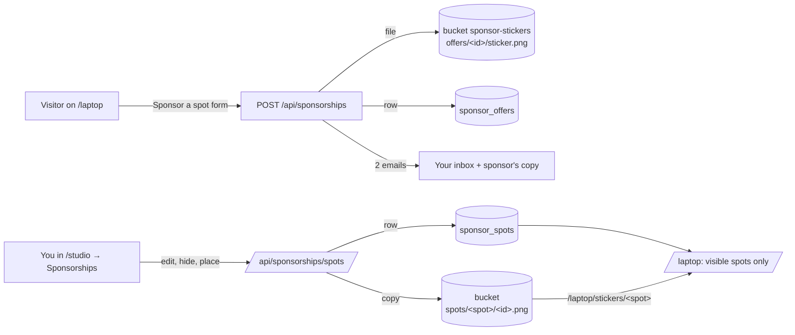

# Sponsorships: setup and day-to-day

_How "Sponsor a spot" on `/laptop` stores offers, how to create the Supabase storage bucket and tables it needs, and how to control what `/laptop` shows from Studio. Last verified against the code: **2026-11-05** (branch `sticker-studio`)._

Related docs: [ARCHITECTURE.md §6.9–6.12 and §7](ARCHITECTURE.md) (routes and tables), [SECURITY.md](SECURITY.md) (why everything is private), [README.md](README.md) (local setup).

---

## 1. What you're setting up

One SQL file, `supabase/sponsorships-schema.sql`, creates all three pieces. It is safe to run more than once.

| Piece | What it holds | Who can touch it |
|---|---|---|
| Storage bucket **`sponsor-stickers`** (private) | Sticker images: what sponsors upload, and the image each spot shows | Only the site's server (service-role key) |
| Table **`sponsor_offers`** | One row per offer sent from the form: email, affiliation, offer, preferred spot, file details, status, your notes | Only the site's server |
| Table **`sponsor_spots`** | What each of the six spots on `/laptop` shows: sponsor name, mark, tagline, description, colour, image, shown or hidden | Only the site's server |

**Allowed files:** PNG or JPG, up to 4 MB, between 64 and 8,000 px on a side (40 megapixels at most). WebP, PDF and SVG are refused, both by the form and by the bucket itself.

**Before the SQL has run** nothing breaks: offers still reach your inbox by email (with the sticker attached), `/laptop` shows the built-in sample stickers, and Studio shows a banner asking you to run the file.

## 2. Create the bucket and tables (recommended: SQL editor)

1. Open your project at [supabase.com/dashboard](https://supabase.com/dashboard).
2. In the left sidebar, choose **SQL Editor**, then **New query**.
3. Open `supabase/sponsorships-schema.sql` from this repo, copy the whole file, and paste it into the editor.
4. Click **Run**. The last four queries print results; check them against step 5.
5. **Check the results.** You should see:
   - **Bucket:** one row, `sponsor-stickers`, with `public = false`, `file_size_limit = 4194304`, and `{image/png,image/jpeg}`.
   - **Tables:** `sponsor_offers` and `sponsor_spots`, both with `rowsecurity = true`.
   - **Spots:** six rows. Four sample sponsors (Acme Dev Tools, Example Cloud, Sample Studio, Demo Robotics) with `sample = true`, and two open spots (`slot-4`, `palm-right`).
   - **Unscoped storage policies:** **no rows.** If any appear, read §6 before going on.
6. In the sidebar, open **Storage**. `sponsor-stickers` should be listed with no "Public" badge.

That's all the setup. No new environment variables are needed: the routes use the `NEXT_PUBLIC_SUPABASE_URL` and `SUPABASE_SERVICE_ROLE_KEY` the site already has. The offer emails need `RESEND_API_KEY` and `SUMMARY_RECIPIENT_EMAIL`, as before.

### Alternative: create the bucket by hand

If you'd rather click through the dashboard for the bucket, you still need to run the SQL file afterwards for the two tables. The file updates an existing bucket to these same settings, so the order doesn't matter.

1. **Storage → New bucket.**
2. **Name:** `sponsor-stickers` (exactly; the code looks for this name).
3. **Public bucket:** leave **off**.
4. Open **Additional configuration**:
   - **Restrict file upload size:** on, **4 MB**.
   - **Allowed MIME types:** `image/png, image/jpeg`.
5. **Create**. Don't add any policies to it. With none, only the service role can read or write it, which is the point.
6. Run `supabase/sponsorships-schema.sql` as in steps 2–5 above.

## 3. Check it works end to end

1. Visit `/laptop` on the live site (or `npm run dev` locally), choose a spot, click **Sponsor a spot**, and send a test offer with a real PNG or JPG.
2. **Your inbox:** the owner email should end with "saved in Studio → Sponsorships". If it says "could NOT be saved to Supabase", see §7.
3. **Supabase → Storage → `sponsor-stickers`:** a folder `offers/<id>/` holds `sticker.png` (or `.jpg`).
4. **`/studio` → Sponsorships:** the offer appears in the **Offers** list with a thumbnail.
5. Click **Place on spot** on the offer. The sticker lands on that spot **hidden**: it shows on Studio's laptop preview, but not yet on `/laptop`.
6. Flip that spot's switch to **Shown**. Visit `/laptop`: the sticker appears, usually on the first visit after the change, and within 5 minutes at most.
7. Clean up: in Studio, **Clear spot** (click twice) and **Delete** the test offer (click twice).

## 4. Using Studio → Sponsorships

Sign in at `/studio` and open the **Sponsorships** tab.

| You want to… | Do this |
|---|---|
| See what visitors see | The laptop at the top uses the same data as `/laptop`. Untick **Show hidden stickers** to see exactly the public view; leave it ticked to preview hidden ones too. |
| Find a spot | Click a sticker on the laptop, or a spot card below it. The two stay in sync: the selected sticker and its card both light up in the sponsor's colour, and pointing at either one lights the other faintly. |
| Hide a sponsor without losing it | Flip the spot's switch to **Hidden**. `/laptop` then shows the spot as open, and the sticker image stops being served. Flip it back any time. |
| Edit what a spot says | Select it, change **Sponsor name**, **Mark** (the up-to-6-letter text drawn when there's no image), **Tagline**, **Description** or **Colour**, then **Save details**. |
| Put a sponsor's sticker on a spot | From the offer card: choose a spot and click **Place on spot**. Or from the spot editor: pick the offer under **Place an offer's sticker here**. Either way it starts hidden, the spot takes the sponsor's affiliation as its name, and the offer is marked accepted. |
| Use your own image | Select a spot that has a sponsor name, then **Upload image** / **Replace image**. |
| Try a sticker on the laptop first | On an offer, **Preview on laptop**: the sticker appears on the spot chosen beside it, a banner says you're previewing, and nothing is saved. **End preview** puts the spot back. |
| Check, adjust and print a sticker | On an offer, **Edit & print** (or click its thumbnail); on a spot with an image, **Edit & print** in the spot editor. See §4a. |
| Remove a sponsor | Select the spot, **Clear spot**, then click again to confirm. The spot becomes open. |
| Handle an offer | **Accept** or **Decline**, keep **Notes** (only you see them), **Download** the file, reply from the email link, or **Delete** it (click twice). Deleting an offer removes its file, but a copy already placed on a spot stays. |

Every change saves straight away and tells `/laptop` to rebuild on its next visit.

## 4a. The sticker editor, and printing on a Cricut

The editor opens the sponsor's original file (for a spot placed from an offer, it goes back to the offer's file, so edits never stack).

- **Check it:** zoom with the − / + buttons, the mouse wheel, a pinch, or `+`/`-` on the keyboard; drag (or use the arrow keys) to move round; **Fit** and **Actual pixels** reset the view. The checkerboard shows what's transparent, and the pink **Cut line** shows where a Cricut will cut. The line under the sticker gives its printed size and how sharply the sponsor's file will print (250+ DPI sharp, 150+ fine, below that it may look soft).
- **Size:** pick the spot (lid stickers 6.5 × 6.5 cm, palm-rest stickers 5 × 3.5 cm, the sizes on the laptop) or a custom size.
- **Shape:** rounded (with a corner radius), circle, or **Follow the logo** (a die-cut outline a set margin round the artwork).
- **Layers, bottom up:** 1) the **sticker colour** filling the shape (white by default, or clear for no fill), 2) an optional coloured **edge** ring, 3) the **artwork**: its size, its position, and **Remove the white background** for logos supplied on white (only white connected to the edges goes, so white inside the logo stays).

Then:

| Button | What happens |
|---|---|
| **Download for Cricut (PNG, 300 DPI)** | Saves the finished sticker at its real size, 300 DPI, transparent outside its shape. |
| **Print at real size** | Prints that many copies at the real size on any printer, for sticker paper you cut by hand. Nothing else on the page prints. |
| **Preview on the laptop** | Closes the editor and shows the finished sticker on the 3D laptop. **Back to the editor** returns to it as you left it. Nothing is saved. |
| **Save as <spot>'s sticker** | Makes it the spot's image. For an offer's sticker, the offer is placed on the spot first, so it starts **hidden** and the offer is marked accepted. |

**Printing on a Cricut.** Cricut has no public API, so a website can't send a job straight to the machine: the file goes through Cricut Design Space.
1. **Download for Cricut**.
2. In Design Space, choose **Upload → Upload Image** and pick the PNG.
3. Its outside is already transparent, so skip background removal and save it as a **Print Then Cut** image.
4. On the canvas, set its size to the one the editor shows (for example 6.5 × 6.5 cm, 2.56 × 2.56 in).
5. **Make It**, print on sticker paper, then load the mat. The machine cuts along the edge the pink line showed.

A saved sticker is stored as `spots/<spot>/<uuid>-cut.png`. That name tells `/laptop` to draw it exactly as designed, instead of placing it on the spot's colour inside a white edge as it does for a plain logo.

**Visitors can preview too.** On `/laptop`, "Preview your logo here" puts a visitor's own PNG or JPG on a spot of the 3D laptop. It stays in their browser (nothing is uploaded), and **Send this as an offer** opens the offer form with that spot and file already filled in.

## 5. What's public and what isn't

- **Never public:** offers (emails, amounts, notes), uploaded files that haven't been placed and shown, hidden spots, and the bucket itself. The anon key and any signed-up Supabase account can't read, list or write them.
- **Public:** for each spot that is **shown**, its name, mark, tagline, description and colour (in `/laptop` and `GET /api/laptop/spots`), plus its image at `/laptop/stickers/<spot>`. That image route serves only shown spots, from the site's own domain, so the bucket never needs to be public and no signed URLs leave the server.
- Images are cached for up to 5 minutes. Hiding a sponsor takes the sticker off `/laptop` at once on the next page build, but a browser that already loaded the image may keep it for those few minutes.

## 6. If the "unscoped storage policies" check returns rows

A policy on `storage.objects` that doesn't name a bucket applies to **every** bucket, including this one. A row in that check means anon or signed-up users might be able to read or list sponsors' files.

1. In **Storage → Policies**, find each listed policy.
2. Edit it so its expression includes `bucket_id = '<the bucket it was meant for>'`.
3. Re-run the last query of `supabase/sponsorships-schema.sql` until it returns no rows.

`supabase/audit-exposure.sql` (SECURITY.md S-23) runs the same check across the whole project.

## 7. Troubleshooting

| Symptom | Cause and fix |
|---|---|
| Studio shows "Run supabase/sponsorships-schema.sql…" | The tables don't exist yet. Run the file (§2). Until then the controls can't save. |
| The owner email says the offer "could NOT be saved to Supabase" | The bucket or `sponsor_offers` is missing, or Supabase was unreachable. Run the SQL file; the server log has a one-time "database schema is behind the code" warning naming which. The email still has the sticker attached. |
| The offer is in Studio but shows "File not saved" | The row saved but the upload didn't (usually a missing bucket). The sticker is attached to the owner email; upload it to the spot yourself with **Upload image**. |
| A shown sticker doesn't appear on `/laptop` | Reload once (the first visit after a change rebuilds the page), then allow up to 5 minutes for caches. Check the spot is **Shown** and has a sponsor name. |
| "That image is too small to print" / "too large" | Images must be 64–8,000 px on a side, at most 40 megapixels. Export a PNG or JPG around 1,000–2,000 px. |
| "Use a PNG or JPG file." | WebP, PDF, SVG and others are refused. Export as PNG or JPG. |
| "Your session expired" in Studio | The admin session lasts 8 hours. Reload and sign in again. |

## 8. REST reference

Everything Studio does goes through these routes, so `/laptop` can also be controlled with plain HTTP calls. The admin routes need the Studio session cookie (sign in at `/studio`) and must come from the site's own pages (SECURITY.md §4.2).

| Method and path | Access | Does |
|---|---|---|
| `POST /api/sponsorships` | public form | Saves an offer (file + row) and sends the two emails |
| `GET /api/sponsorships` | admin | `{ offers, setup }`, newest first |
| `PATCH /api/sponsorships` | admin | `{ id, status?, notes? }`: status `new`, `accepted` or `declined` |
| `DELETE /api/sponsorships` | admin | `{ id }`: deletes the offer and its `offers/` file |
| `GET /api/sponsorships/spots` | admin | `{ spots, setup }`: all six spots, hidden ones included |
| `PATCH /api/sponsorships/spots` | admin | `{ id, visible?, sponsor?, offerId?, removeImage? }`: `sponsor: null` clears the spot; `offerId` places that offer's sticker (hidden unless `visible` is sent) |
| `POST /api/sponsorships/spots` | admin | multipart `{ id, sticker, finish? }`: a new image for a spot that has a sponsor name. `finish=sticker` marks a finished die-cut PNG from the editor (stored as `…-cut.png`, drawn as designed) |
| `GET /api/sponsorships/file?path=` | admin | Streams a stored file (`&download=1` to save it) |
| `GET /api/laptop/spots` | public | The six spots as `/laptop` shows them (hidden ones as open) |
| `GET /laptop/stickers/<spot>` | public | A shown spot's sticker image; 404 otherwise |
